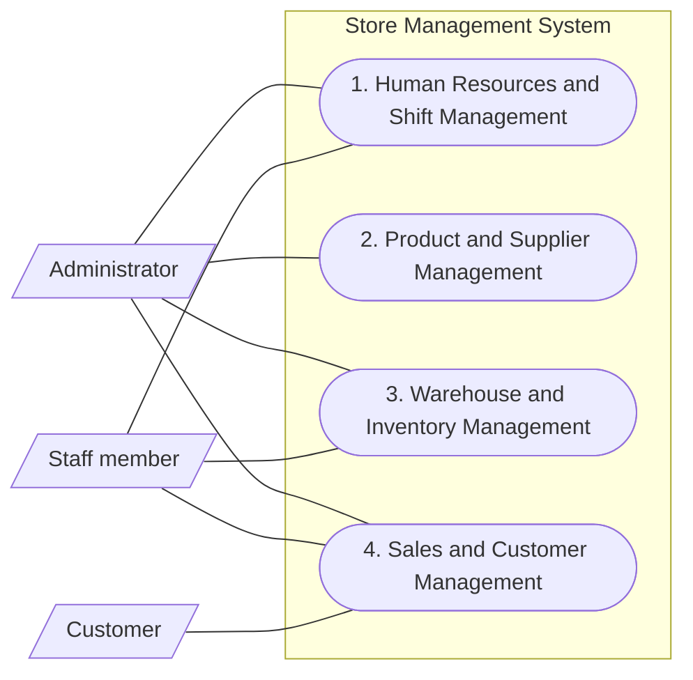

# System General Use Case Diagram — 4 Main Functions

This high-level diagram groups the system's functions into four main use cases. The detailed use cases and their original UC-01 through UC-19 identifiers remain in [04_use_case_chi_tiet.md](./04_use_case_chi_tiet.md).

## Main Use Cases

Each use case below is an umbrella for the detailed functions listed in [04_use_case_chi_tiet.md](./04_use_case_chi_tiet.md). Customers participate in counter sales but do not log in or operate the system directly.

| No. | Main Use Case | Actors | Included detailed use cases |
|---|---|---|---|
| 1 | Human Resources and Shift Management | Administrator, Staff | UC-01 through UC-06 |
| 2 | Product and Supplier Management | Administrator | UC-07 through UC-11 |
| 3 | Warehouse and Inventory Management | Administrator, Staff | UC-12 through UC-15 |
| 4 | Sales and Customer Management | Administrator, Staff, Customer | UC-16 through UC-19 |
