# 19 Top-Level Use Cases and Detailed Sub-Use Cases

This document specifies the 19 top-level use cases shown in the
[general use case diagram](./03_so_do_usecase_tong_quat.md). UC-01 through UC-19
use the same identifiers and titles in both documents. Each top-level function
is decomposed into smaller use cases, with actors connected directly to each
sub-use case. Sub-use-case descriptions use the Purpose, Inputs, and Outputs
format. They refine the 19 top-level functions and do not increase that count.
Customers participate in counter transactions but do not log in to or directly
operate the system.
Employee profiles, accounts, roles, and authentication are covered by UC-01;
work-hour reporting, payroll, and commissions by UC-05; stock adjustments and
movement history by UC-14; and promotions and loyalty-point policies and history
by UC-18. Category and supplier reporting are described under UC-10 and UC-11.

## Group 1 — Human Resources and Scheduling

### UC-01 — Employee Records, Accounts, and Roles

- **Purpose:** Allows the Administrator to manage employee records and system access accounts, including Administrator and Staff roles.
- **Primary actor:** Administrator
- **Preconditions:** The Administrator is signed in and has permission to manage employees and accounts.
- **Inputs:** Employee identifier; name and contact details; job title or work assignment; base salary and required employment information; employment status; search criteria; username, role, and account status.
- **Outputs:** A new employee record; matching employee list or details; an updated or deactivated employee record when employment ends; updated account and role; validation errors for missing required data or duplicate employee identifiers/usernames.
- **Postconditions:** Employee records and account or role changes are saved. An employee who leaves is marked inactive rather than deleted.

**Sub-use case diagram and actor associations:**

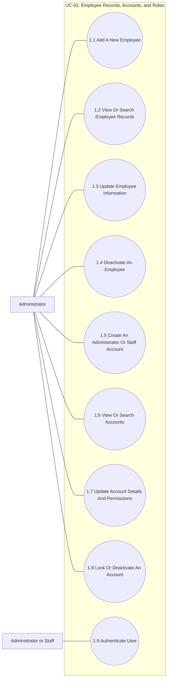

#### 1.1. Add A New Employee

- **Purpose:** Allows the user to add a new employee.
- **Inputs:** Employee identifier; full name and contact details; job title or work assignment; base salary and other required employment information.
- **Outputs:** A new employee record; a list or detail view of matching employee records; an updated employee record; an inactive or deactivated employee record when employment ends.

#### 1.2. View Or Search Employee Records

- **Purpose:** Allows the user to view or search employee records.
- **Inputs:** Employee identifier; full name and contact details; employment status; search criteria or employee identifier when viewing a record.
- **Outputs:** A list or detail view of matching employee records.

#### 1.3. Update Employee Information

- **Purpose:** Allows the user to update employee information.
- **Inputs:** Employee identifier; full name and contact details; job title or work assignment; base salary and other required employment information; employment status.
- **Outputs:** An updated employee record; a validation message if required information is missing or the identifier already exists.

#### 1.4. Deactivate An Employee

- **Purpose:** Allows the user to deactivate an employee; an employee with related records is not physically deleted.
- **Inputs:** Employee identifier; employment status; search criteria or employee identifier when viewing a record.
- **Outputs:** An inactive or deactivated employee record when employment ends.

#### 1.5. Create An Administrator Or Staff Account

- **Purpose:** Allows the user to create an Administrator or Staff account.
- **Inputs:** Linked employee; username and initial or reset password; account role and assigned permissions.
- **Outputs:** A new account linked to an employee; account details or a list of accounts; a validation message if the username is already in use or the account is invalid.

#### 1.6. View Or Search Accounts

- **Purpose:** Allows the user to view or search accounts.
- **Inputs:** Linked employee; account status; search criteria or account identifier.
- **Outputs:** Account details or a list of accounts.

#### 1.7. Update Account Details And Permissions

- **Purpose:** Allows the user to update account details and permissions.
- **Inputs:** Linked employee; username; account role and assigned permissions; account status.
- **Outputs:** Updated role, permissions, or account information; a validation message if the username is already in use or the account is invalid.

#### 1.8. Lock Or Deactivate An Account

- **Purpose:** Allows the user to lock or deactivate an account.
- **Inputs:** Account status; search criteria or account identifier.
- **Outputs:** A locked or deactivated account.

#### 1.9. Authenticate User

- **Purpose:** Allows an Administrator or Staff member to authenticate and access functions permitted by their role.
- **Inputs:** Username or account identifier; password.
- **Outputs:** An authenticated session and the appropriate application dashboard when credentials are valid; an error when credentials are invalid, the account is inactive, or access is denied; a recorded login event where audit logging is enabled.

> Customer accounts are not created. Customers need login an.

#### Account Management Flow Diagram

- **Purpose:** Allows the Administrator to create, update, or deactivate system accounts and assign roles.
- **Inputs:** Linked employee; username; credentials; Administrator or Staff role; account status.
- **Outputs:** A created, updated, or deactivated account with its role saved; an error if the username is duplicated or the information is invalid.

### UC-02 — Employee Availability

- **Purpose:** Allows Staff to submit their availability for the following week for the Administrator to use when scheduling shifts.
- **Inputs:** Employee; date; available start and end times; optional note.
- **Outputs:** Saved availability; submission confirmation or an error if the date or time slot is invalid or cannot be saved.
- **Primary actors:** Staff; Administrator (view availability)
- **Preconditions:** Staff is signed in, and the next-week availability period is open.
- **Postconditions:** The employee's availability is saved for use in shift scheduling.

**Sub-use case diagram and actor associations:**

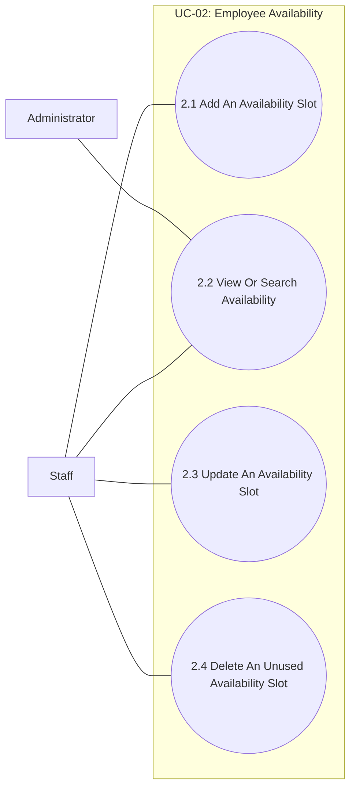

#### 2.1. Add An Availability Slot

- **Purpose:** Allows Staff to add an availability slot.
- **Inputs:** Employee identifier; availability date or recurring day; start and end times; optional note.
- **Outputs:** A saved availability record.

#### 2.2. View Or Search Availability

- **Purpose:** Allows the user to view or search availability.
- **Inputs:** Employee identifier; availability date or recurring day; search period or employee identifier.
- **Outputs:** A list or calendar view of availability.

#### 2.3. Update An Availability Slot

- **Purpose:** Allows Staff to update an availability slot.
- **Inputs:** Employee identifier; availability date or recurring day; start and end times; optional note.
- **Outputs:** A saved or updated availability slot; a validation message if the time range is invalid or overlaps another entry.

#### 2.4. Delete An Unused Availability Slot

- **Purpose:** Allows Staff to delete an availability slot that has not been used in a finalized schedule.
- **Inputs:** Employee identifier; availability date or recurring day; search period or employee identifier.
- **Outputs:** An updated or removed availability slot.

### UC-03 — Shift Scheduling

- **Purpose:** Allows the Administrator to assign employees to shifts, resolve uncovered shifts or scheduling conflicts, and publish the work schedule.
- **Inputs:** Scheduling week; shift coverage requirements; availability; employees; shifts; assignments and publication status.
- **Outputs:** A saved or published store schedule; assigned shifts; uncovered shifts or conflicts recorded for resolution.
- **Primary actors:** Administrator; Staff (view assigned shifts)
- **Preconditions:** Shift definitions and employee availability are available.
- **Postconditions:** The store schedule is saved and published, and employees can view their assigned shifts.

**Sub-use case diagram and actor associations:**

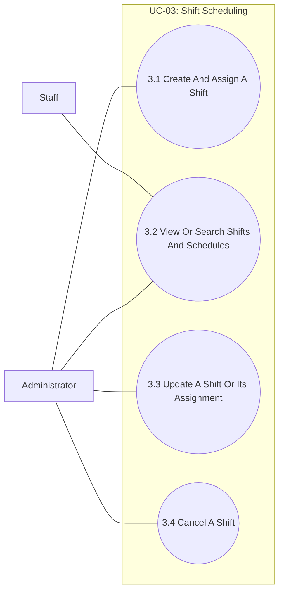

#### 3.1. Create And Assign A Shift

- **Purpose:** Allows the user to create and assign a shift.
- **Inputs:** Shift identifier; assigned employee or employees; work date; start and end times.
- **Outputs:** A saved shift and its employee assignment; a schedule or shift detail view; a conflict warning if an employee has overlapping shifts or the shift data is invalid.

#### 3.2. View Or Search Shifts And Schedules

- **Purpose:** Allows the user to view or search shifts and schedules.
- **Inputs:** Shift identifier; assigned employee or employees; work date; optional notes or status; search period, employee, or shift identifier.
- **Outputs:** A schedule or shift detail view; a printable or exportable schedule when supported.

#### 3.3. Update A Shift Or Its Assignment

- **Purpose:** Allows the user to update a shift or its assignment.
- **Inputs:** Shift identifier; assigned employee or employees; work date; start and end times; optional notes or status.
- **Outputs:** A saved shift and assignment; an updated shift.

#### 3.4. Cancel A Shift

- **Purpose:** Allows the user to cancel a shift that is no longer required.
- **Inputs:** Shift identifier; work date; optional notes or status; search period, employee, or shift identifier.
- **Outputs:** An updated or cancelled shift.

### UC-04 — Attendance

- **Purpose:** Allows Staff to record actual check-in and check-out times and the Administrator to review attendance data.
- **Inputs:** Employee and assigned shift; check-in time; check-out time; optional note.
- **Outputs:** A saved attendance record or an error if the shift, record, or time is invalid.
- **Primary actors:** Staff (record attendance); Administrator (view and review)
- **Preconditions:** The employee and relevant work schedule have been set up.
- **Postconditions:** Actual check-in and check-out times are saved as attendance data.

**Sub-use case diagram and actor associations:**

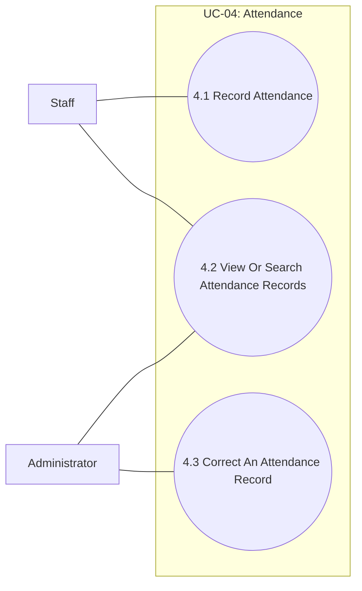

#### 4.1. Record Attendance

- **Purpose:** Allows Staff to record attendance for an assigned shift.
- **Inputs:** Employee and shift identifiers; check-in and check-out times; attendance status; correction reason when amending a record.
- **Outputs:** A saved attendance record; a validation message if the employee or shift does not match.

#### 4.2. View Or Search Attendance Records

- **Purpose:** Allows the user to view or search attendance records.
- **Inputs:** Employee and shift identifiers; attendance status; search period or employee identifier.
- **Outputs:** Attendance details or a filtered attendance list.

#### 4.3. Correct An Attendance Record

- **Purpose:** Allows an authorized user to correct an attendance record with a reason.
- **Inputs:** Employee and shift identifiers; corrected check-in and check-out times; attendance status; correction reason.
- **Outputs:** A corrected attendance record with its reason and audit information; a validation message if the employee or shift does not match.

### UC-05 — Work Hours, Payroll, and Commissions

- **Purpose:** Allows the Administrator to report scheduled shifts, actual work hours, and shift coverage, prepare and review payroll, and manage commission rules.
- **Inputs:** Reporting or payroll period; optional employee filters; schedules and attendance; salary and commission data; payroll adjustments and reasons; commission rules.
- **Outputs:** Shift and work-hour reports; draft or finalized payroll records; saved commission rules; validation errors when data or calculations are invalid.
- **Primary actor:** Administrator
- **Preconditions:** Schedule and attendance data are available for the selected period; payroll and commission source data are available when required.
- **Postconditions:** The requested report is displayed, or payroll and commission data are saved with the applicable status.

**Sub-use case diagram and actor associations:**

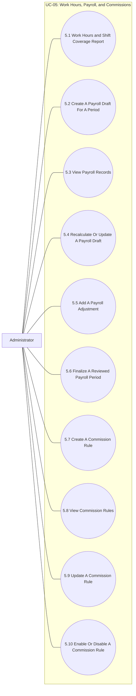

#### 5.1. Work Hours and Shift Coverage Report

- **Purpose:** Allows the Administrator to review scheduled shifts, actual work hours, and shift coverage for a selected period.
- **Inputs:** Reporting period; optional employee filters; shift schedules and attendance records.
- **Outputs:** A report of scheduled shifts, actual hours, and shift coverage; a no-data message when there are no matching records.

#### 5.2. Create A Payroll Draft For A Period

- **Purpose:** Allows an authorized user to prepare a payroll draft for a selected pay period.
- **Inputs:** Payroll period; employee or employee group; salary and attendance data; eligible commission totals; authorized adjustment amount and reason.
- **Outputs:** A draft payroll summary by employee and pay period; a validation message if source data is incomplete.

#### 5.3. View Payroll Records

- **Purpose:** Allows an authorized user to review payroll records.
- **Inputs:** Payroll period; employee or employee group; draft or finalized status.
- **Outputs:** Payroll summaries and calculated salary, attendance totals, commission, adjustments, and final amount.

#### 5.4. Recalculate Or Update A Payroll Draft

- **Purpose:** Allows an authorized user to recalculate or update a draft payroll.
- **Inputs:** Payroll period; employee or employee group; salary and attendance data; eligible commission totals; authorized adjustment amount and reason.
- **Outputs:** Recalculated salary, attendance totals, commission, adjustments, and final amount; a validation message if source data is incomplete.

#### 5.5. Add A Payroll Adjustment

- **Purpose:** Allows an authorized user to add a payroll adjustment with a reason.
- **Inputs:** Payroll period; employee or employee group; adjustment amount and reason.
- **Outputs:** An updated draft payroll summary.

#### 5.6. Finalize A Reviewed Payroll Period

- **Purpose:** Allows an authorized user to finalize a reviewed payroll period.
- **Inputs:** Payroll period; employee or employee group; payroll status.
- **Outputs:** A finalized payroll record; a validation message if the period cannot be finalized.

> Finalized payroll records are retained. They are not deleted or edited without an authorized, auditable correction process.

#### 5.7. Create A Commission Rule

- **Purpose:** Allows the Administrator to create a commission rule used in payroll.
- **Inputs:** Commission rule name; rate or calculation method; effective dates; eligibility conditions; rule status.
- **Outputs:** A saved commission rule; a validation message if the rate, dates, or conditions are invalid.

#### 5.8. View Commission Rules

- **Purpose:** Allows the user to view commission rules.
- **Inputs:** Commission rule name; effective dates; rule status.
- **Outputs:** A list or detail view of commission rules.

#### 5.9. Update A Commission Rule

- **Purpose:** Allows the Administrator to update a commission rule.
- **Inputs:** Commission rule name; rate or calculation method; effective dates; eligibility conditions; rule status.
- **Outputs:** An updated commission rule; a validation message if the rate, dates, or conditions are invalid.

#### 5.10. Enable Or Disable A Commission Rule

- **Purpose:** Allows the Administrator to enable or disable a commission rule.
- **Inputs:** Commission rule effective dates; rule status.
- **Outputs:** An enabled or disabled commission rule.

> Commission calculations use completed sales attributed to the responsible employee. The Administrator configures the rate and eligibility rules.

### UC-06 — Schedule Compliance and Punctuality Reports

- **Purpose:** Allows the Administrator to compare scheduled shifts with attendance times and assess shift compliance and punctuality.
- **Inputs:** Date range; optional employee scope; shift schedule; actual check-in and check-out times.
- **Outputs:** A schedule-compliance and punctuality report, or a message when no matching data is available.
- **Primary actor:** Administrator
- **Preconditions:** Shift schedules and corresponding attendance records are available.
- **Postconditions:** The comparison between scheduled and actual work times is displayed.

**Sub-use case diagram and actor associations:**

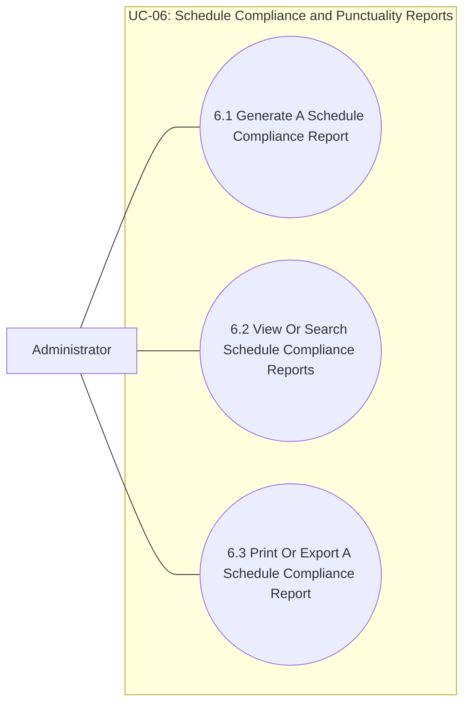

#### 6.1. Generate A Schedule Compliance Report

- **Purpose:** Allows the Administrator to generate a schedule-compliance and punctuality report.
- **Inputs:** Date range; optional employee scope; shift schedules and attendance records.
- **Outputs:** A report comparing scheduled shifts with actual attendance; a no-data message when there are no matching records.

#### 6.2. View Or Search Schedule Compliance Reports

- **Purpose:** Allows the Administrator to review reports for a selected period or employee.
- **Inputs:** Date range; optional employee identifier.
- **Outputs:** A matching report or a no-results message.

#### 6.3. Print Or Export A Schedule Compliance Report

- **Purpose:** Allows the Administrator to produce a shareable copy of a generated report.
- **Inputs:** Selected report and supported output format.
- **Outputs:** A printable or exported report when supported.

## Group 2 — Products and Suppliers

### UC-07 — Product Categories

- **Purpose:** Allows the Administrator to create, update, and deactivate product categories.
- **Inputs:** Category name; description; status; requested operation.
- **Outputs:** A created, updated, or deactivated category; an error if data is duplicated or invalid, or the category is still referenced.
- **Primary actor:** Administrator
- **Preconditions:** The Administrator is signed in and has permission to manage categories.
- **Postconditions:** The category is created, updated, or deactivated.

**Sub-use case diagram and actor associations:**

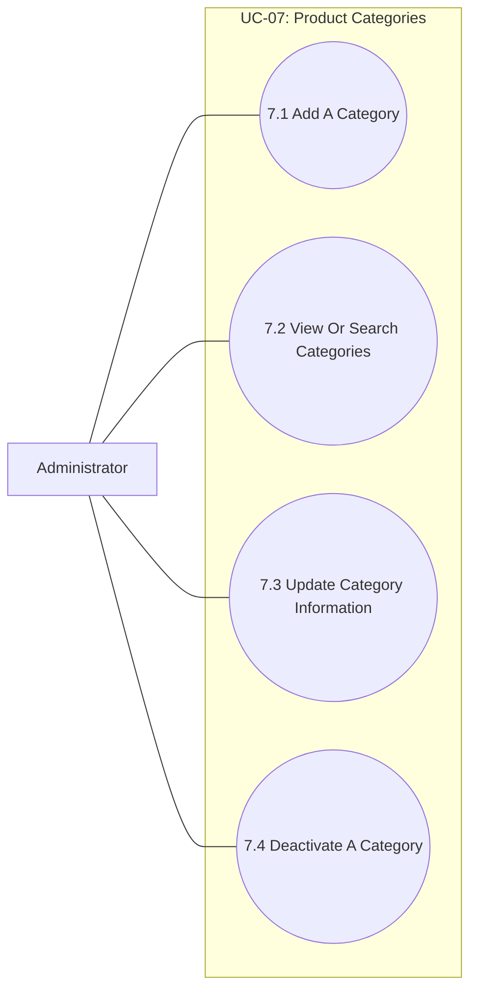

#### 7.1. Add A Category

- **Purpose:** Allows the user to add a product category.
- **Inputs:** Category identifier or code; category name; description.
- **Outputs:** A new category; a category list or detail view; a validation message if required data is missing or the code is already in use.

#### 7.2. View Or Search Categories

- **Purpose:** Allows the user to view or search categories.
- **Inputs:** Category identifier or code; category name; category status; search criteria or category identifier.
- **Outputs:** A category list or detail view.

#### 7.3. Update Category Information

- **Purpose:** Allows the user to update category information.
- **Inputs:** Category identifier or code; category name; description; category status.
- **Outputs:** An updated category; a validation message if required data is missing or the code is already in use.

#### 7.4. Deactivate A Category

- **Purpose:** Allows the user to deactivate a category.
- **Inputs:** Category identifier or code; category status; search criteria or category identifier.
- **Outputs:** A deactivated category. Categories referenced by products are deactivated rather than physically deleted.

### UC-08 — Products

- **Purpose:** Allows the Administrator to maintain product information and business status.
- **Inputs:** Product code and name; category; dosage form; unit; barcode; prescription requirement; status.
- **Outputs:** A created, updated, or discontinued product, or an error if the data is invalid.
- **Primary actor:** Administrator
- **Preconditions:** The required category exists.
- **Postconditions:** Product information is saved in the catalog.

**Sub-use case diagram and actor associations:**

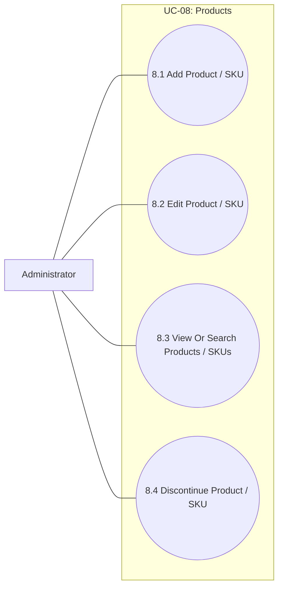

#### 8.1. Add Product / SKU

- **Purpose:** Allows the user to add a product to the catalog.
- **Inputs:** SKU or product code; product name; unit of measure; selling price; product category; required product details.
- **Outputs:** A new product record; a validation message if required data is missing, the SKU is duplicated, or the price is invalid.

#### 8.2. Edit Product / SKU

- **Purpose:** Allows the user to update product information.
- **Inputs:** SKU or product code; product name; unit of measure; selling price; product category; required product details; product status.
- **Outputs:** An updated product record; a validation message if required fields are missing, the SKU is duplicated, or the price is invalid.

#### 8.3. View Or Search Products / SKUs

- **Purpose:** Allows the user to view or search products.
- **Inputs:** SKU or product code; product name; product category; product details and status; search criteria or product identifier.
- **Outputs:** A product list or detail view.

#### 8.4. Discontinue Product / SKU

- **Purpose:** Allows the user to discontinue or deactivate a product.
- **Inputs:** Product status; search criteria, SKU, or product identifier.
- **Outputs:** A discontinued or deactivated product.

> Product catalog maintenance does not directly create or update stock quantities.

### UC-09 — Suppliers

- **Purpose:** Allows the Administrator to maintain supplier contact information and status.
- **Inputs:** Supplier identifier and name; phone number; email; address; status; requested operation.
- **Outputs:** Created or updated supplier information, or an updated status while preserving related history.
- **Primary actor:** Administrator
- **Preconditions:** The Administrator is signed in and has permission to manage suppliers.
- **Postconditions:** Supplier contact information and status are saved.

**Sub-use case diagram and actor associations:**

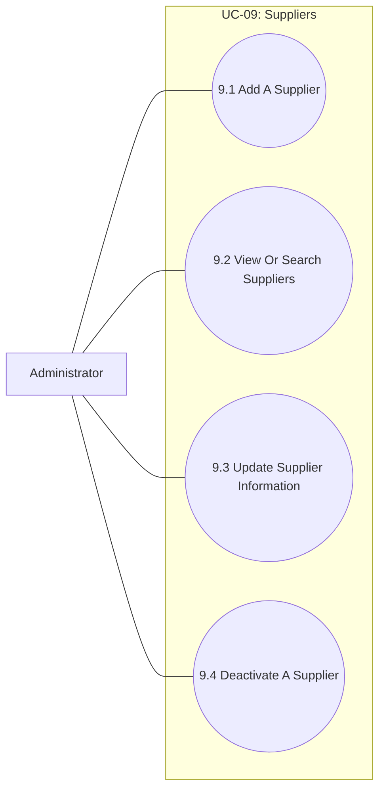

#### 9.1. Add A Supplier

- **Purpose:** Allows the user to add a supplier.
- **Inputs:** Supplier identifier; supplier name; contact person and contact details; address and other required supplier information.
- **Outputs:** A new supplier record; a validation message if required data is missing or the identifier is duplicated.

#### 9.2. View Or Search Suppliers

- **Purpose:** Allows the user to view or search suppliers.
- **Inputs:** Supplier identifier; supplier name; address and other required information; supplier status; search criteria or supplier identifier.
- **Outputs:** A supplier list or detail view.

#### 9.3. Update Supplier Information

- **Purpose:** Allows the user to update supplier information.
- **Inputs:** Supplier identifier; supplier name; contact person and contact details; address and other required information; supplier status.
- **Outputs:** An updated supplier record; a validation message if required information is missing or the identifier is duplicated.

#### 9.4. Deactivate A Supplier

- **Purpose:** Allows the user to deactivate a supplier.
- **Inputs:** Supplier identifier; supplier status; search criteria or supplier identifier.
- **Outputs:** An inactive supplier record.

### UC-10 — Category Trend Reports

- **Purpose:** Allows the Administrator to compare product counts across categories to assess the product mix.
- **Inputs:** Reporting scope; optional product status; category and product data.
- **Outputs:** Product counts by category and comparison results, or a message when no data is available.
- **Primary actor:** Administrator
- **Preconditions:** Products have been assigned to categories.
- **Postconditions:** Product counts by category are displayed.

**Sub-use case diagram and actor associations:**

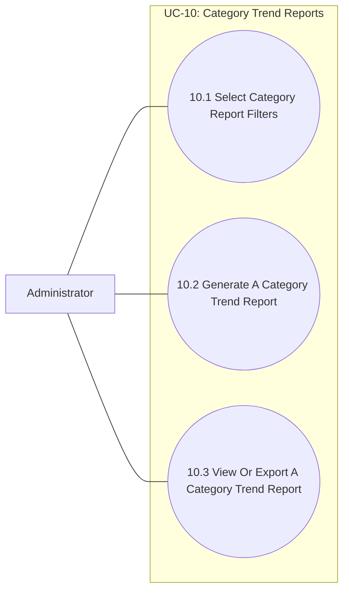

#### 10.1. Select Category Report Filters

- **Purpose:** Allows the Administrator to choose the category scope and product status for reporting.
- **Inputs:** Category scope; optional product status.
- **Outputs:** Validated report criteria or a validation message.

#### 10.2. Generate A Category Trend Report

- **Purpose:** Allows the Administrator to calculate product counts and compare categories.
- **Inputs:** Validated report criteria; category and product data.
- **Outputs:** Product counts and category comparisons, or a no-data message.

#### 10.3. View Or Export A Category Trend Report

- **Purpose:** Allows the Administrator to review or export the generated category report.
- **Inputs:** Generated report; requested output format when exporting.
- **Outputs:** A displayed report or an export when supported.

### UC-11 — Supplier Coverage Reports

- **Purpose:** Allows the Administrator to assess each supplier's product coverage and share.
- **Inputs:** Reporting scope; product-supplier links.
- **Outputs:** Product counts and shares by supplier and supplier concentration or distribution, or a message when no linked data is available.
- **Primary actor:** Administrator
- **Preconditions:** Products are linked to suppliers.
- **Postconditions:** Supplier product coverage and shares are displayed.

**Sub-use case diagram and actor associations:**

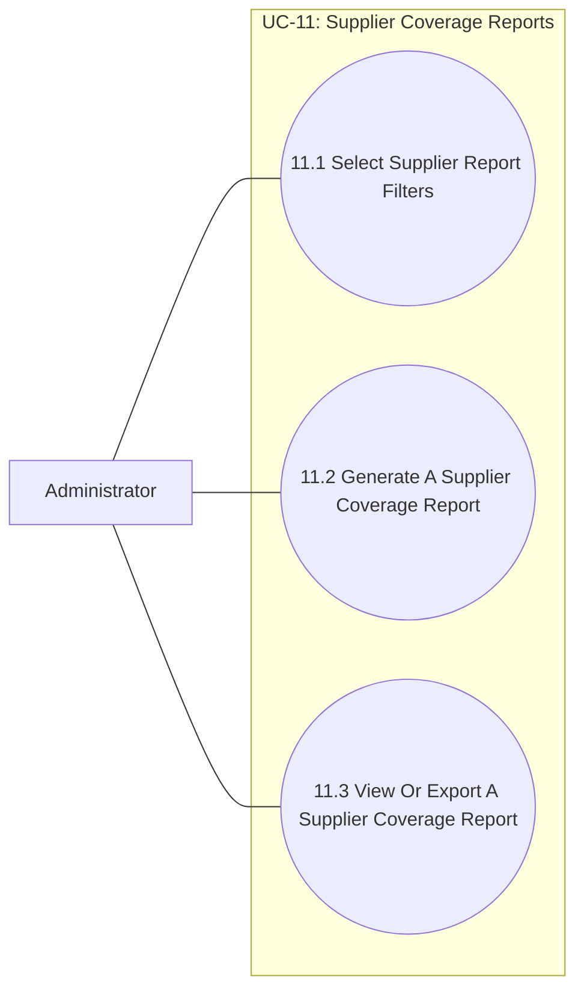

#### 11.1. Select Supplier Report Filters

- **Purpose:** Allows the Administrator to choose the supplier and product scope for reporting.
- **Inputs:** Supplier scope; optional product status or category.
- **Outputs:** Validated report criteria or a validation message.

#### 11.2. Generate A Supplier Coverage Report

- **Purpose:** Allows the Administrator to calculate product counts and shares by supplier.
- **Inputs:** Validated report criteria; product-supplier links.
- **Outputs:** Supplier coverage and share results, or a no-data message.

#### 11.3. View Or Export A Supplier Coverage Report

- **Purpose:** Allows the Administrator to review or export the generated supplier report.
- **Inputs:** Generated report; requested output format when exporting.
- **Outputs:** A displayed report or an export when supported.

## Group 3 — Inventory

### UC-12 — Stock Receipts

- **Purpose:** Allows authorized users to record goods received from suppliers and update inventory by batch and location.
- **Inputs:** Supplier; products; batch numbers; quantities; expiry dates; storage locations; costs and receipt details.
- **Outputs:** A saved receipt and batch details; updated stock and inventory movements; an error if the data is invalid or an update fails.
- **Primary actors:** Administrator; authorized Staff
- **Preconditions:** The supplier and products exist in the system.
- **Postconditions:** The receipt and batch details are recorded, and stock is updated.

**Sub-use case diagram and actor associations:**

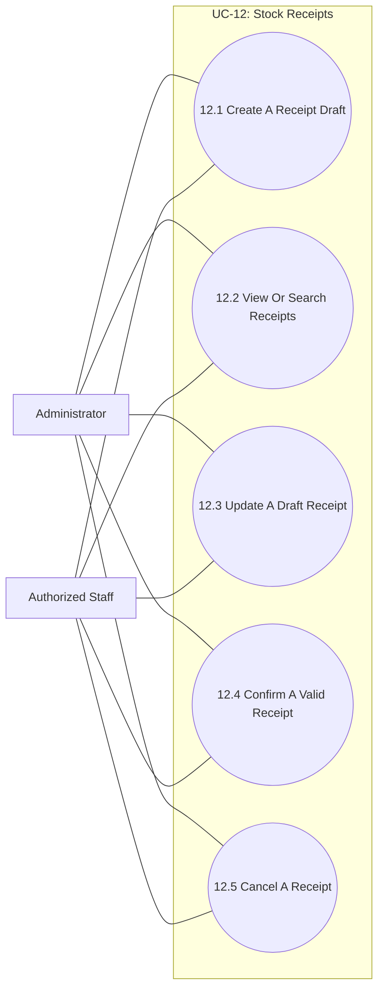

#### 12.1. Create A Receipt Draft

- **Purpose:** Allows an authorized user to create a draft goods receipt.
- **Inputs:** System-generated receipt identifier; supplier; receipt date; one or more product lines with quantity and purchase price; optional notes.
- **Outputs:** A saved receipt draft; a receipt detail view or list.

#### 12.2. View Or Search Receipts

- **Purpose:** Allows the user to view or search receipts.
- **Inputs:** Receipt identifier; supplier; receipt date; receipt status.
- **Outputs:** A receipt detail view or list; a validation message if supplier, product, quantity, or purchase price is invalid.

#### 12.3. Update A Draft Receipt

- **Purpose:** Allows the user to update a receipt before confirmation.
- **Inputs:** Receipt identifier; supplier; receipt date; product lines with quantity and purchase price; optional notes.
- **Outputs:** An updated draft; a validation message if receipt details are invalid.

#### 12.4. Confirm A Valid Receipt

- **Purpose:** Allows an authorized user to confirm a valid receipt and post its inventory effects.
- **Inputs:** Receipt identifier; receipt date; draft status.
- **Outputs:** A confirmed receipt; updated stock quantities and an inventory movement record.

#### 12.5. Cancel A Receipt

- **Purpose:** Allows an authorized user to cancel a receipt according to authorization and audit rules.
- **Inputs:** Receipt identifier; receipt date; receipt status.
- **Outputs:** A cancelled receipt with its status recorded.

> The receipt workflow does not require a separate purchase order. A confirmed receipt is retained and is not physically deleted.

### UC-13 — Storage Locations

- **Purpose:** Allows the Administrator to manage physical locations used to store, organize, and find goods.
- **Inputs:** Location name or code; area, cabinet, shelf, and level details; create, update, or deactivate operation.
- **Outputs:** A created, updated, or deactivated location; a message if the location is duplicated or still contains stock.
- **Primary actor:** Administrator
- **Preconditions:** The Administrator is signed in and has permission to manage locations.
- **Postconditions:** The physical storage structure is updated for organization and lookup.

**Sub-use case diagram and actor associations:**

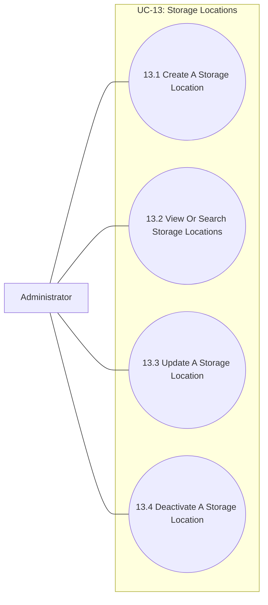

#### 13.1. Create A Storage Location

- **Purpose:** Allows the Administrator to add a physical storage location.
- **Inputs:** Location name or code; area, cabinet, shelf, and level details.
- **Outputs:** A saved location; a validation message if required details are missing or the location is duplicated.

#### 13.2. View Or Search Storage Locations

- **Purpose:** Allows the Administrator to find and review storage locations.
- **Inputs:** Location identifier or name; area, cabinet, shelf, level, or status search criteria.
- **Outputs:** A matching location list or detail view.

#### 13.3. Update A Storage Location

- **Purpose:** Allows the Administrator to update location details.
- **Inputs:** Existing location; updated name or code and physical location details.
- **Outputs:** An updated location; a validation message if the location does not exist or the new details are invalid.

#### 13.4. Deactivate A Storage Location

- **Purpose:** Allows the Administrator to stop using an empty storage location.
- **Inputs:** Location identifier; deactivation request.
- **Outputs:** A deactivated location, or a message requiring existing stock to be moved first.

### UC-14 — Stocktaking and Adjustments

- **Purpose:** Allows authorized users to count physical stock, compare it with system quantities, and confirm stock adjustments.
- **Inputs:** Stocktake scope; products, batches, or locations; actual quantities; adjustment confirmation.
- **Outputs:** A saved stocktake session and variance results; updated stock and inventory movements when approved.
- **Primary actors:** Administrator; authorized Staff
- **Preconditions:** Products or batches are available for stocktaking.
- **Postconditions:** The stocktake session is saved; variances are recorded and applied when confirmed.

**Sub-use case diagram and actor associations:**

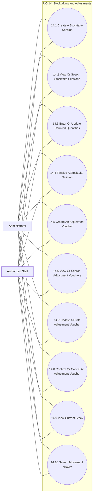

#### 14.1. Create A Stocktake Session

- **Purpose:** Allows an authorized user to create a stocktake session.
- **Inputs:** Stocktake session identifier; date and responsible Staff member; products included; actual counted quantities; optional notes.
- **Outputs:** A new stocktake session; a session list or detail view; a variance report; validation errors for invalid quantities or status.

#### 14.2. View Or Search Stocktake Sessions

- **Purpose:** Allows the user to view or search sessions.
- **Inputs:** Session identifier; stocktake date; responsible Staff member; products; session status.
- **Outputs:** A session list or detail view and variance report.

#### 14.3. Enter Or Update Counted Quantities

- **Purpose:** Allows the user to enter or update counts before a session is finalized.
- **Inputs:** Session identifier; products; actual counted quantities; optional notes; session status.
- **Outputs:** Updated count entries while the session is a draft; a validation message if quantities or status are invalid.

#### 14.4. Finalize A Stocktake Session

- **Purpose:** Allows an authorized user to finalize a session and apply its variances.
- **Inputs:** Stocktake session identifier; responsible Staff member; session status.
- **Outputs:** A variance report; updated stock and inventory movement records.

> A finalized stocktake is retained with its inventory effects and audit history.

#### 14.5. Create An Adjustment Voucher

- **Purpose:** Allows an authorized user to create a justified stock adjustment draft outside the stocktake process.
- **Inputs:** System-generated voucher identifier; product; quantity increase or decrease; required reason; creation date; responsible Staff member; optional notes.
- **Outputs:** A saved adjustment draft; a validation message if the reason is missing or the adjustment would result in invalid stock.

#### 14.6. View Or Search Adjustment Vouchers

- **Purpose:** Allows the user to view or search adjustment vouchers.
- **Inputs:** Voucher identifier; product; creation date; responsible Staff member; voucher status.
- **Outputs:** An adjustment detail view or list.

#### 14.7. Update A Draft Adjustment Voucher

- **Purpose:** Allows an authorized user to update an adjustment before confirmation.
- **Inputs:** Voucher identifier; product; quantity increase or decrease; required reason; creation date; responsible Staff member; optional notes.
- **Outputs:** An updated draft; a validation message if the reason is missing or the adjustment would result in invalid stock.

#### 14.8. Confirm Or Cancel An Adjustment Voucher

- **Purpose:** Allows an authorized user to confirm or cancel a voucher according to authorization and audit rules.
- **Inputs:** Voucher identifier; required reason; creation date; responsible Staff member; voucher status.
- **Outputs:** A confirmed or cancelled adjustment; updated stock and an inventory movement record when confirmed.

> Stock adjustments are separate from stocktake sessions. Confirmed vouchers are retained and are not physically deleted.

#### 14.9. View Current Stock

- **Purpose:** Allows the user to view current stock.
- **Inputs:** Product or SKU; optional date range; movement type; optional transaction or voucher identifier.
- **Outputs:** Current stock quantity and, when requested, filtered inventory movement history; an empty-result message when no records match.

#### 14.10. Search Movement History

- **Purpose:** Allows the user to search inventory movement history.
- **Inputs:** Product or SKU; optional date range; movement type; optional transaction or voucher identifier.
- **Outputs:** Filtered movement history showing date, movement type, quantity change, reference, and responsible user when available; an empty-result message when no records match.

### UC-15 — Inventory Movement and Expiry Reports

- **Purpose:** Allows the Administrator to review inventory movements and identify damaged or expired goods that need attention.
- **Inputs:** Date range; product scope; movement history; stocktake results; batch and expiry information.
- **Outputs:** Reports on receipts, issues, adjustments, and other movements; a list of damaged or expired goods; a message when no data is available.
- **Primary actor:** Administrator
- **Preconditions:** Inventory movement history and batch condition or expiry information are available.
- **Postconditions:** Movement reports and items requiring attention are displayed for the selected scope.

**Sub-use case diagram and actor associations:**

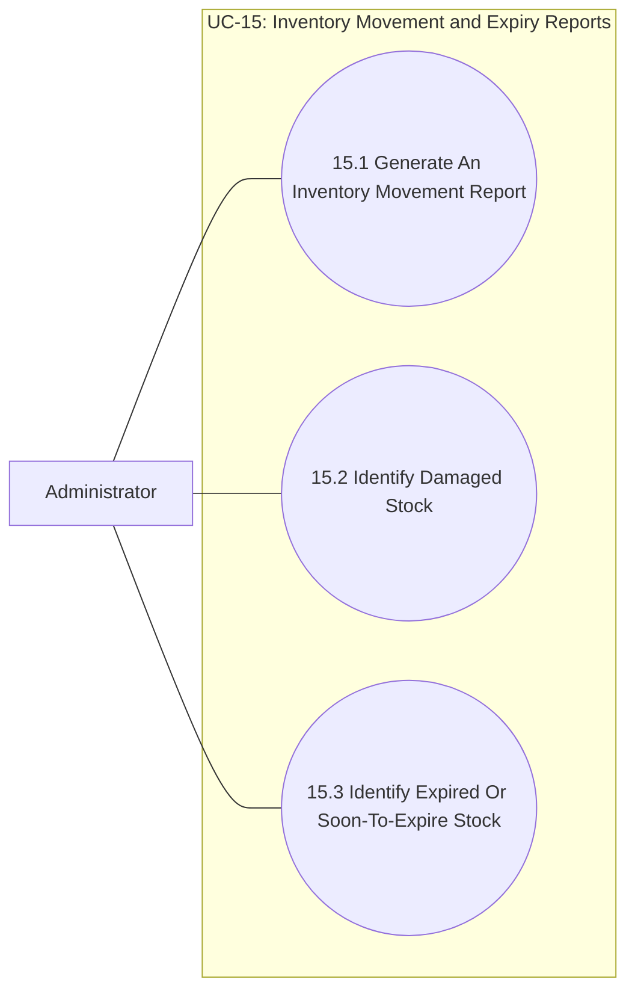

#### 15.1. Generate An Inventory Movement Report

- **Purpose:** Allows the Administrator to summarize receipts, issues, adjustments, and other stock movements.
- **Inputs:** Date range; product scope; inventory movement history.
- **Outputs:** A filtered movement report or a no-data message.

#### 15.2. Identify Damaged Stock

- **Purpose:** Allows the Administrator to identify damaged goods recorded during stocktakes or other inventory operations.
- **Inputs:** Product and batch data; stocktake results; recorded damage status.
- **Outputs:** A list of damaged goods requiring review.

#### 15.3. Identify Expired Or Soon-To-Expire Stock

- **Purpose:** Allows the Administrator to identify expired or soon-to-expire batches.
- **Inputs:** Product and batch data; expiry dates; reporting date or date range.
- **Outputs:** A list of expired or soon-to-expire stock requiring action.

## Group 4 — Sales and Customers

### UC-16 — Customer Profiles, Allergies, and Loyalty Points

- **Purpose:** Allows authorized Staff to manage contact information and customer-reported allergies and to look up loyalty points.
- **Inputs:** Customer identification and contact details; customer-reported allergy information; points inquiry.
- **Outputs:** A created or updated customer profile or allergy record; displayed points balance and related information; an error if profile data is invalid or duplicated.
- **Primary actors:** Administrator; authorized Staff
- **Preconditions:** Staff is signed in.
- **Postconditions:** The customer profile, customer-reported allergies, and points information are updated.

**Sub-use case diagram and actor associations:**

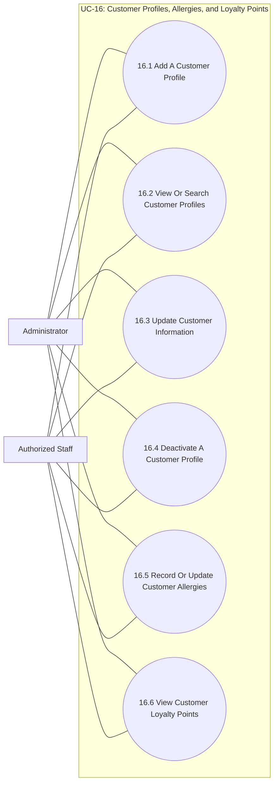

#### 16.1. Add A Customer Profile

- **Purpose:** Allows authorized Staff to add a customer profile.
- **Inputs:** System-generated customer identifier; customer name; phone number and optional contact information; other pharmacy-required information subject to access restrictions.
- **Outputs:** A new customer profile.

#### 16.2. View Or Search Customer Profiles

- **Purpose:** Allows authorized Staff to view or search customer profiles.
- **Inputs:** Customer identifier; customer name; customer status; search criteria or customer identifier.
- **Outputs:** A customer list or detail view.

#### 16.3. Update Customer Information

- **Purpose:** Allows authorized Staff to update customer information.
- **Inputs:** Customer identifier; customer name; phone number and optional contact information; permitted pharmacy information; customer status.
- **Outputs:** An updated customer profile; a validation message if information is invalid or a duplicate is detected.

#### 16.4. Deactivate A Customer Profile

- **Purpose:** Allows authorized Staff to deactivate a customer profile.
- **Inputs:** Customer identifier; customer status; search criteria or customer identifier.
- **Outputs:** A deactivated customer profile.

#### 16.5. Record Or Update Customer Allergies

- **Purpose:** Allows authorized Staff to record or update allergies reported by the customer.
- **Inputs:** Customer identifier; allergy information provided by the customer; update date or note.
- **Outputs:** Saved allergy information linked to the customer profile; a validation message if the customer or information is invalid.

#### 16.6. View Customer Loyalty Points

- **Purpose:** Allows authorized Staff to view a customer's current loyalty-point balance.
- **Inputs:** Customer identifier; authorized user credentials.
- **Outputs:** Current points balance and related history when available; an access or not-found message when the profile cannot be accessed.

> Customers do not have login accounts. Access to sensitive profile information is restricted to authorized Staff.

### UC-17 — Sales Transactions

- **Purpose:** Allows Staff to create counter sales, calculate totals, accept payment, and update stock or points when eligible.
- **Inputs:** Products; quantities; optional customer profile; eligible promotions or points redemption; payment information.
- **Outputs:** An invoice and transaction details; updated stock, inventory movements, and points when applicable; a message if stock is insufficient or payment is incomplete.
- **Primary actors:** Staff; Administrator; Counter Customer
- **Preconditions:** The product is available for sale, and the employee is authorized to create transactions.
- **Postconditions:** The transaction is saved, and related stock and points are updated when applicable.

**Sub-use case diagram and actor associations:**

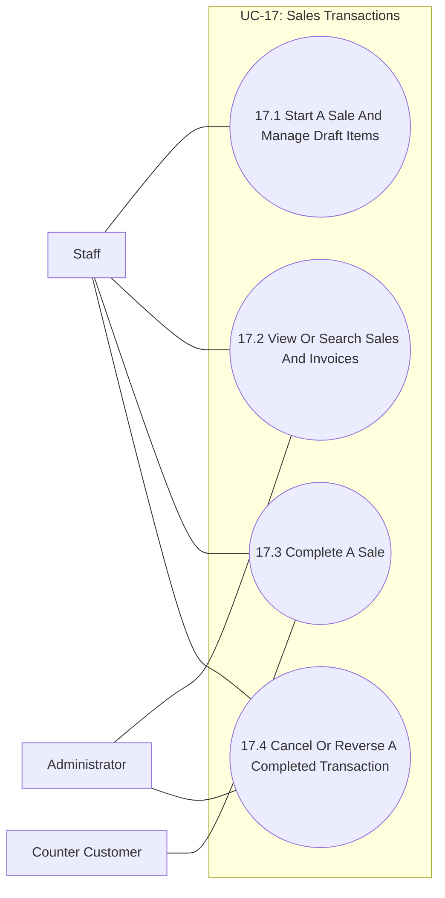

#### 17.1. Start A Sale And Manage Draft Items

- **Purpose:** Allows Staff to start a sale and add, update, or remove items while it is a draft.
- **Inputs:** Product items and quantities; optional customer profile; eligible promotion; points to redeem if permitted; payment method and amount; responsible Staff member.
- **Outputs:** A sale draft with product lines and calculated totals; an updated draft before completion.

#### 17.2. View Or Search Sales And Invoices

- **Purpose:** Allows authorized users to view or search sales and invoices.
- **Inputs:** Sale or invoice identifier; customer profile if applicable; date or other supported search criteria.
- **Outputs:** A sale or invoice detail view or filtered list.

#### 17.3. Complete A Sale

- **Purpose:** Allows Staff to complete a sale after validating prices, stock, discounts, and payment.
- **Inputs:** Product items and quantities; optional customer; eligible discounts or points to redeem; payment method and amount; responsible Staff member.
- **Outputs:** A completed sale and invoice after successful payment; updated inventory and movement history; earned loyalty points and points-history entry when eligible; a printable receipt or invoice; validation or payment error if completion fails.

#### 17.4. Cancel Or Reverse A Completed Transaction

- **Purpose:** Allows an authorized user to cancel or reverse a completed transaction through an auditable process.
- **Inputs:** Completed sale or invoice identifier; authorization; reason and supporting transaction details.
- **Outputs:** A recorded cancellation or reversal with corresponding inventory, payment, and loyalty-ledger effects and audit history.

> Product prices and stock are validated through catalog and inventory functions. Customers participate at the counter but do not operate the application.

### UC-18 — Promotions and Loyalty Points

- **Purpose:** Allows the Administrator to configure promotions and rules for earning and redeeming loyalty points.
- **Inputs:** Promotion details, eligibility, dates, and status; points-earning rate; points-conversion rules and rate.
- **Outputs:** Saved promotion and loyalty settings applied according to status; an error if data or dates are invalid.
- **Primary actor:** Administrator
- **Preconditions:** The Administrator is signed in and has permission to configure sales.
- **Postconditions:** Promotions and points-earning or redemption rules are saved with their applicable status.

**Sub-use case diagram and actor associations:**

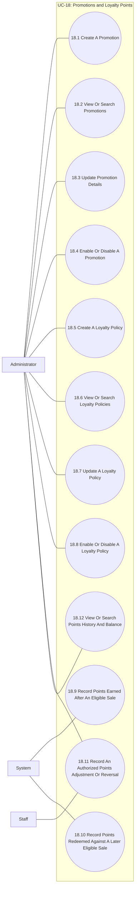

#### 18.1. Create A Promotion

- **Purpose:** Allows the Administrator to create a time-limited promotion for eligible counter sales.
- **Inputs:** Promotion identifier and name; discount type and value; start and end dates; eligibility conditions.
- **Outputs:** A new promotion; a validation message if discount, dates, or conditions are invalid.

#### 18.2. View Or Search Promotions

- **Purpose:** Allows the user to view or search promotions.
- **Inputs:** Promotion identifier and name; discount type; dates; promotion status; search criteria.
- **Outputs:** A promotion list or detail view.

#### 18.3. Update Promotion Details

- **Purpose:** Allows the Administrator to update promotion details.
- **Inputs:** Promotion identifier and name; discount type and value; dates; eligibility conditions; promotion status.
- **Outputs:** An updated promotion; a validation message if discount, dates, or conditions are invalid.

#### 18.4. Enable Or Disable A Promotion

- **Purpose:** Allows the Administrator to enable or disable a promotion.
- **Inputs:** Promotion identifier; promotion status; search criteria or identifier.
- **Outputs:** An enabled or disabled promotion.

#### 18.5. Create A Loyalty Policy

- **Purpose:** Allows the Administrator to configure how customers earn points and how points convert to discounts.
- **Inputs:** Earning rule or points per eligible transaction; point-to-currency conversion rate; effective dates and policy conditions.
- **Outputs:** A saved loyalty policy; a validation message if the rule, conversion rate, or dates are invalid.

#### 18.6. View Or Search Loyalty Policies

- **Purpose:** Allows the user to view or search loyalty policies.
- **Inputs:** Policy name and status; effective dates or other conditions.
- **Outputs:** A policy list or detail view.

#### 18.7. Update A Loyalty Policy

- **Purpose:** Allows the Administrator to update a loyalty policy.
- **Inputs:** Policy name and status; earning rule; point-to-currency conversion rate; effective dates and conditions.
- **Outputs:** An updated policy; a validation message if the rule, conversion rate, or dates are invalid.

#### 18.8. Enable Or Disable A Loyalty Policy

- **Purpose:** Allows the Administrator to enable or disable a loyalty policy.
- **Inputs:** Policy name and status; earning rule; conversion rate; effective dates and conditions.
- **Outputs:** An enabled or disabled policy.

#### 18.9. Record Points Earned After An Eligible Sale

- **Purpose:** Allows the system to record points earned after an eligible sale is paid.
- **Inputs:** Customer profile; completed sale or authorized adjustment reference; points earned.
- **Outputs:** A points-history entry linked to the customer and transaction and an updated balance derived from the ledger; a validation message if the customer or transaction is invalid.

#### 18.10. Record Points Redeemed Against A Later Eligible Sale

- **Purpose:** Allows the system to record points redeemed against a later eligible sale.
- **Inputs:** Customer profile; completed sale reference; points to redeem; applicable policy.
- **Outputs:** A redemption ledger entry; a validation message if the customer, transaction, or requested redemption is invalid or the balance is insufficient.

#### 18.11. Record An Authorized Points Adjustment Or Reversal

- **Purpose:** Allows an authorized user to adjust or reverse points with a reason.
- **Inputs:** Customer profile; transaction or adjustment reference; points to adjust or reverse; reason.
- **Outputs:** An auditable points-history entry; a validation message if the customer, transaction, or requested change is invalid.

#### 18.12. View Or Search Points History And Balance

- **Purpose:** Allows authorized users to view or search points history and balance.
- **Inputs:** Customer profile; customer identifier or date range.
- **Outputs:** A filtered points-history view and current balance derived from the ledger; a validation message if the customer or search criteria are invalid.

> Policy changes do not silently alter existing points-history records. Points balances must be supported by ledger entries. Promotions are separate from loyalty-point policies.

### UC-19 — Order and Revenue Reports

- **Purpose:** Allows the Administrator to report the number of sales transactions and revenue for a selected period.
- **Inputs:** Date range; filters; sales transaction data.
- **Outputs:** An order-count and revenue report, or a message when no matching transactions are available.
- **Primary actor:** Administrator
- **Preconditions:** Sales transaction data is available for the selected period.
- **Postconditions:** Order counts and revenue for the period are displayed.

**Sub-use case diagram and actor associations:**

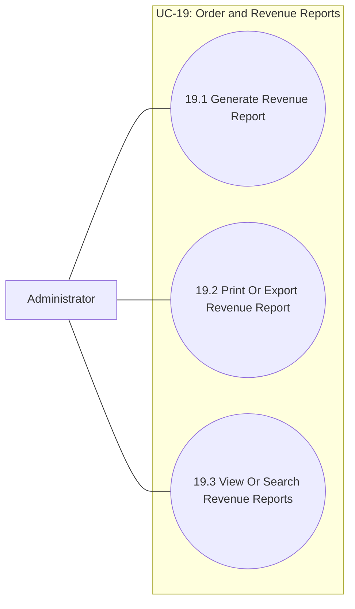

#### 19.1. Generate Revenue Report

- **Purpose:** Allows the Administrator to generate a revenue report for a selected period.
- **Inputs:** Start and end dates; optional grouping and supported filters.
- **Outputs:** Revenue totals and breakdown based on completed sales; an empty-result message when no sales match.

#### 19.2. Print Or Export Revenue Report

- **Purpose:** Allows the Administrator to print or export a revenue report.
- **Inputs:** Start and end dates; optional grouping and supported filters.
- **Outputs:** A report table or chart and a print or export view when supported.

#### 19.3. View Or Search Revenue Reports

- **Purpose:** Allows the Administrator to view or find a previously generated report.
- **Inputs:** Reporting period; supported search filters.
- **Outputs:** A matching report or a no-results message.

> Revenue reporting is read-only and does not modify sales, invoices, payments, or inventory.
