# E-NK Pharma ? Database ERD

Logical relational model inferred from UC-01 through UC-19 in FORM 02A. The diagrams use **Chen ER notation**: entities are rectangles, named relationships are diamonds, and each relationship line is annotated with its cardinality. `PK` means primary key, `FK` foreign key, `UK` unique key, and `nullable` an optional foreign key. The ERD is split into domain diagrams for readability; entities may appear in more than one diagram when a relationship crosses domains.

## Identity, scheduling, attendance, and payroll

```mermaid
flowchart LR
E_Employee["<b>Employee</b><br/>PK int employee_id<br/>UK string employee_code<br/>string full_name<br/>string phone<br/>string email<br/>string job_title<br/>decimal base_salary<br/>date hire_date<br/>string employment_status"]
E_UserAccount["<b>UserAccount</b><br/>PK int account_id<br/>FK UK int employee_id<br/>FK int role_id<br/>UK string username<br/>string password_hash<br/>string account_status"]
E_Role["<b>Role</b><br/>PK int role_id<br/>UK string role_name"]
E_RolePermission["<b>RolePermission</b><br/>PK int role_permission_id<br/>FK int role_id<br/>FK int permission_id"]
E_Permission["<b>Permission</b><br/>PK int permission_id<br/>UK string permission_code<br/>string permission_name"]
E_AccountPermission["<b>AccountPermission</b><br/>PK int account_permission_id<br/>FK int account_id<br/>FK int permission_id<br/>string grant_status"]
E_EmployeeAvailability["<b>EmployeeAvailability</b><br/>PK int availability_id<br/>FK int employee_id<br/>date available_date<br/>string recurring_day<br/>time start_time<br/>time end_time<br/>string note"]
E_ShiftAssignment["<b>ShiftAssignment</b><br/>PK int assignment_id<br/>FK int shift_id<br/>FK int employee_id<br/>string assignment_status"]
E_Shift["<b>Shift</b><br/>PK int shift_id<br/>date work_date<br/>time start_time<br/>time end_time<br/>string shift_status<br/>string note"]
E_Attendance["<b>Attendance</b><br/>PK int attendance_id<br/>FK UK int assignment_id<br/>datetime check_in<br/>datetime check_out<br/>string attendance_status"]
E_AttendanceCorrection["<b>AttendanceCorrection</b><br/>PK int correction_id<br/>FK int attendance_id<br/>FK int corrected_by_employee_id<br/>datetime old_check_in<br/>datetime old_check_out<br/>datetime new_check_in<br/>datetime new_check_out<br/>string reason<br/>datetime corrected_at"]
E_PayrollPeriod["<b>PayrollPeriod</b><br/>PK int payroll_period_id<br/>date period_start<br/>date period_end<br/>string period_status"]
E_Payroll["<b>Payroll</b><br/>PK int payroll_id<br/>FK int payroll_period_id<br/>FK int employee_id<br/>decimal base_amount<br/>decimal hours_amount<br/>decimal commission_amount<br/>decimal adjustment_total<br/>decimal gross_amount<br/>string payroll_status<br/>datetime finalized_at"]
E_PayrollAdjustment["<b>PayrollAdjustment</b><br/>PK int payroll_adjustment_id<br/>FK nullable int payroll_id<br/>FK int created_by_employee_id<br/>decimal amount<br/>string reason<br/>datetime created_at"]
E_CommissionRule["<b>CommissionRule</b><br/>PK int commission_rule_id<br/>UK string rule_name<br/>string calculation_method<br/>decimal rate<br/>date effective_from<br/>date effective_to<br/>string eligibility_conditions<br/>string rule_status"]
E_CommissionEarning["<b>CommissionEarning</b><br/>PK int commission_earning_id<br/>FK int commission_rule_id<br/>FK int employee_id<br/>FK int sale_id<br/>FK int payroll_id<br/>decimal eligible_amount<br/>decimal commission_amount"]
E_Sale["<b>Sale</b><br/>PK int sale_id<br/>FK nullable int customer_id<br/>FK int employee_id<br/>datetime sold_at<br/>decimal subtotal<br/>decimal discount_total<br/>decimal total_amount<br/>string sale_status"]
E_ProductCategory["<b>ProductCategory</b><br/>PK int category_id<br/>UK string category_code<br/>string category_name<br/>string description<br/>string category_status"]
E_Product["<b>Product</b><br/>PK int product_id<br/>FK int category_id<br/>UK string sku<br/>UK string barcode<br/>string product_name<br/>string dosage_form<br/>string unit_of_measure<br/>decimal selling_price<br/>boolean prescription_required<br/>string product_status"]
E_Supplier["<b>Supplier</b><br/>PK int supplier_id<br/>UK string supplier_code<br/>string supplier_name<br/>string contact_person<br/>string phone<br/>string email<br/>string address<br/>string supplier_status"]
E_SupplierProduct["<b>SupplierProduct</b><br/>PK int supplier_product_id<br/>FK int supplier_id<br/>FK int product_id<br/>string supplier_product_code<br/>string link_status"]
E_StockReceipt["<b>StockReceipt</b><br/>PK int receipt_id<br/>FK int supplier_id<br/>FK int recorded_by_employee_id<br/>date receipt_date<br/>string receipt_status<br/>string note"]
E_ProductBatch["<b>ProductBatch</b><br/>PK int batch_id<br/>FK int product_id<br/>FK int supplier_id<br/>UK string batch_code<br/>date expiry_date<br/>decimal purchase_cost"]
E_ReceiptLine["<b>ReceiptLine</b><br/>PK int receipt_line_id<br/>FK int receipt_id<br/>FK int batch_id<br/>FK int location_id<br/>decimal quantity_received<br/>decimal purchase_price"]
E_StorageLocation["<b>StorageLocation</b><br/>PK int location_id<br/>UK string location_code<br/>string area<br/>string cabinet<br/>string shelf<br/>string level<br/>string location_status"]
E_InventoryBalance["<b>InventoryBalance</b><br/>PK int inventory_balance_id<br/>FK int batch_id<br/>FK int location_id<br/>decimal quantity_on_hand"]
E_StockMovement["<b>StockMovement</b><br/>PK int movement_id<br/>FK int batch_id<br/>FK int location_id<br/>FK int recorded_by_employee_id<br/>string movement_type<br/>decimal quantity_change<br/>string reference_type<br/>int reference_id<br/>datetime occurred_at"]
E_Stocktake["<b>Stocktake</b><br/>PK int stocktake_id<br/>FK int responsible_employee_id<br/>date stocktake_date<br/>string stocktake_status<br/>string note"]
E_StocktakeLine["<b>StocktakeLine</b><br/>PK int stocktake_line_id<br/>FK int stocktake_id<br/>FK int batch_id<br/>FK int location_id<br/>decimal system_quantity<br/>decimal counted_quantity"]
E_StockAdjustment["<b>StockAdjustment</b><br/>PK int stock_adjustment_id<br/>FK int created_by_employee_id<br/>datetime created_at<br/>string adjustment_status<br/>string note"]
E_StockAdjustmentLine["<b>StockAdjustmentLine</b><br/>PK int adjustment_line_id<br/>FK int stock_adjustment_id<br/>FK int batch_id<br/>FK int location_id<br/>decimal quantity_change<br/>string reason"]
E_Customer["<b>Customer</b><br/>PK int customer_id<br/>string full_name<br/>string phone<br/>string email<br/>string customer_status"]
E_CustomerAllergy["<b>CustomerAllergy</b><br/>PK int customer_allergy_id<br/>FK int customer_id<br/>FK int recorded_by_employee_id<br/>string allergy_description<br/>string note<br/>datetime recorded_at"]
E_SaleLine["<b>SaleLine</b><br/>PK int sale_line_id<br/>FK int sale_id<br/>FK int product_id<br/>decimal quantity<br/>decimal unit_price<br/>decimal discount_amount<br/>decimal line_total"]
E_Payment["<b>Payment</b><br/>PK int payment_id<br/>FK int sale_id<br/>string payment_method<br/>decimal amount<br/>datetime paid_at<br/>string payment_status"]
E_SalePromotion["<b>SalePromotion</b><br/>PK int sale_promotion_id<br/>FK int sale_id<br/>FK int promotion_id<br/>decimal discount_amount"]
E_Promotion["<b>Promotion</b><br/>PK int promotion_id<br/>UK string promotion_name<br/>string discount_type<br/>decimal discount_value<br/>datetime starts_at<br/>datetime ends_at<br/>string eligibility_conditions<br/>string promotion_status"]
E_LoyaltyLedger["<b>LoyaltyLedger</b><br/>PK int loyalty_entry_id<br/>FK int customer_id<br/>FK nullable int sale_id<br/>FK nullable int loyalty_policy_id<br/>FK int recorded_by_employee_id<br/>string entry_type<br/>decimal points_change<br/>string reason<br/>datetime recorded_at"]
E_LoyaltyPolicy["<b>LoyaltyPolicy</b><br/>PK int loyalty_policy_id<br/>UK string policy_name<br/>decimal points_per_currency<br/>decimal currency_per_point<br/>date effective_from<br/>date effective_to<br/>string policy_status"]
E_ReportRun["<b>ReportRun</b><br/>PK int report_run_id<br/>FK int generated_by_employee_id<br/>string report_type<br/>date period_start<br/>date period_end<br/>string filters<br/>datetime generated_at"]

REL_01{"has login account"}
E_Employee ---|"1"| REL_01
REL_01 ---|"0..1"| E_UserAccount
REL_02{"assigned to accounts"}
E_Role ---|"1"| REL_02
REL_02 ---|"n"| E_UserAccount
REL_03{"grants permission"}
E_Role ---|"1"| REL_03
REL_03 ---|"n"| E_RolePermission
REL_04{"included in roles"}
E_Permission ---|"1"| REL_04
REL_04 ---|"n"| E_RolePermission
REL_05{"has permission override"}
E_UserAccount ---|"1"| REL_05
REL_05 ---|"n"| E_AccountPermission
REL_06{"overridden for accounts"}
E_Permission ---|"1"| REL_06
REL_06 ---|"n"| E_AccountPermission
REL_07{"submits availability"}
E_Employee ---|"1"| REL_07
REL_07 ---|"n"| E_EmployeeAvailability
REL_08{"assigned to shifts"}
E_Employee ---|"1"| REL_08
REL_08 ---|"n"| E_ShiftAssignment
REL_09{"has assignees"}
E_Shift ---|"1"| REL_09
REL_09 ---|"n"| E_ShiftAssignment
REL_10{"records attendance"}
E_ShiftAssignment ---|"1"| REL_10
REL_10 ---|"0..1"| E_Attendance
REL_11{"has correction history"}
E_Attendance ---|"1"| REL_11
REL_11 ---|"n"| E_AttendanceCorrection
REL_12{"records correction"}
E_Employee ---|"1"| REL_12
REL_12 ---|"n"| E_AttendanceCorrection
REL_13{"contains payrolls"}
E_PayrollPeriod ---|"1"| REL_13
REL_13 ---|"n"| E_Payroll
REL_14{"receives payroll"}
E_Employee ---|"1"| REL_14
REL_14 ---|"n"| E_Payroll
REL_15{"has adjustments"}
E_Payroll ---|"1"| REL_15
REL_15 ---|"n"| E_PayrollAdjustment
REL_16{"creates payroll adjustment"}
E_Employee ---|"1"| REL_16
REL_16 ---|"n"| E_PayrollAdjustment
REL_17{"calculates earning"}
E_CommissionRule ---|"1"| REL_17
REL_17 ---|"n"| E_CommissionEarning
REL_18{"earns commission"}
E_Employee ---|"1"| REL_18
REL_18 ---|"n"| E_CommissionEarning
REL_19{"generates commission"}
E_Sale ---|"1"| REL_19
REL_19 ---|"n"| E_CommissionEarning
REL_20{"includes commission"}
E_Payroll ---|"1"| REL_20
REL_20 ---|"n"| E_CommissionEarning
REL_21{"categorizes products"}
E_ProductCategory ---|"1"| REL_21
REL_21 ---|"n"| E_Product
REL_22{"supplies product link"}
E_Supplier ---|"1"| REL_22
REL_22 ---|"n"| E_SupplierProduct
REL_23{"has supplier link"}
E_Product ---|"1"| REL_23
REL_23 ---|"n"| E_SupplierProduct
REL_24{"delivers receipts"}
E_Supplier ---|"1"| REL_24
REL_24 ---|"n"| E_StockReceipt
REL_25{"records receipt"}
E_Employee ---|"1"| REL_25
REL_25 ---|"n"| E_StockReceipt
REL_26{"tracked in batches"}
E_Product ---|"1"| REL_26
REL_26 ---|"n"| E_ProductBatch
REL_27{"provides batch"}
E_Supplier ---|"1"| REL_27
REL_27 ---|"n"| E_ProductBatch
REL_28{"contains receipt lines"}
E_StockReceipt ---|"1"| REL_28
REL_28 ---|"n"| E_ReceiptLine
REL_29{"received as batch"}
E_ProductBatch ---|"1"| REL_29
REL_29 ---|"n"| E_ReceiptLine
REL_30{"received at location"}
E_StorageLocation ---|"1"| REL_30
REL_30 ---|"n"| E_ReceiptLine
REL_31{"has location balance"}
E_ProductBatch ---|"1"| REL_31
REL_31 ---|"n"| E_InventoryBalance
REL_32{"stores batch balance"}
E_StorageLocation ---|"1"| REL_32
REL_32 ---|"n"| E_InventoryBalance
REL_33{"has movement"}
E_ProductBatch ---|"1"| REL_33
REL_33 ---|"n"| E_StockMovement
REL_34{"movement at location"}
E_StorageLocation ---|"1"| REL_34
REL_34 ---|"n"| E_StockMovement
REL_35{"records movement"}
E_Employee ---|"1"| REL_35
REL_35 ---|"n"| E_StockMovement
REL_36{"responsible for"}
E_Employee ---|"1"| REL_36
REL_36 ---|"n"| E_Stocktake
REL_37{"counts lines"}
E_Stocktake ---|"1"| REL_37
REL_37 ---|"n"| E_StocktakeLine
REL_38{"counted as batch"}
E_ProductBatch ---|"1"| REL_38
REL_38 ---|"n"| E_StocktakeLine
REL_39{"counted at location"}
E_StorageLocation ---|"1"| REL_39
REL_39 ---|"n"| E_StocktakeLine
REL_40{"creates stock adjustment"}
E_Employee ---|"1"| REL_40
REL_40 ---|"n"| E_StockAdjustment
REL_41{"contains adjustment lines"}
E_StockAdjustment ---|"1"| REL_41
REL_41 ---|"n"| E_StockAdjustmentLine
REL_42{"adjusts batch"}
E_ProductBatch ---|"1"| REL_42
REL_42 ---|"n"| E_StockAdjustmentLine
REL_43{"adjusts at location"}
E_StorageLocation ---|"1"| REL_43
REL_43 ---|"n"| E_StockAdjustmentLine
REL_44{"reports allergies"}
E_Customer ---|"1"| REL_44
REL_44 ---|"n"| E_CustomerAllergy
REL_45{"records allergy"}
E_Employee ---|"1"| REL_45
REL_45 ---|"n"| E_CustomerAllergy
REL_46{"participates in sale"}
E_Customer ---|"0..1"| REL_46
REL_46 ---|"n"| E_Sale
REL_47{"processes sale"}
E_Employee ---|"1"| REL_47
REL_47 ---|"n"| E_Sale
REL_48{"contains sale lines"}
E_Sale ---|"1"| REL_48
REL_48 ---|"n"| E_SaleLine
REL_49{"sold as sale line"}
E_Product ---|"1"| REL_49
REL_49 ---|"n"| E_SaleLine
REL_50{"has payments"}
E_Sale ---|"1"| REL_50
REL_50 ---|"n"| E_Payment
REL_51{"applies promotion"}
E_Sale ---|"1"| REL_51
REL_51 ---|"n"| E_SalePromotion
REL_52{"used in sales"}
E_Promotion ---|"1"| REL_52
REL_52 ---|"n"| E_SalePromotion
REL_53{"has points history"}
E_Customer ---|"1"| REL_53
REL_53 ---|"n"| E_LoyaltyLedger
REL_54{"referenced by points entry"}
E_Sale ---|"0..1"| REL_54
REL_54 ---|"n"| E_LoyaltyLedger
REL_55{"governs points entry"}
E_LoyaltyPolicy ---|"0..1"| REL_55
REL_55 ---|"n"| E_LoyaltyLedger
REL_56{"records points entry"}
E_Employee ---|"1"| REL_56
REL_56 ---|"n"| E_LoyaltyLedger
REL_57{"generates report"}
E_Employee ---|"1"| REL_57
REL_57 ---|"n"| E_ReportRun

classDef entity fill:#D9EAF7,stroke:#1F4E78,color:#111111;
classDef relation fill:#FFF2CC,stroke:#BF9000,color:#111111;
class E_Employee,E_UserAccount,E_Role,E_RolePermission,E_Permission,E_AccountPermission,E_EmployeeAvailability,E_ShiftAssignment,E_Shift,E_Attendance,E_AttendanceCorrection,E_PayrollPeriod,E_Payroll,E_PayrollAdjustment,E_CommissionRule,E_CommissionEarning,E_Sale,E_ProductCategory,E_Product,E_Supplier,E_SupplierProduct,E_StockReceipt,E_ProductBatch,E_ReceiptLine,E_StorageLocation,E_InventoryBalance,E_StockMovement,E_Stocktake,E_StocktakeLine,E_StockAdjustment,E_StockAdjustmentLine,E_Customer,E_CustomerAllergy,E_SaleLine,E_Payment,E_SalePromotion,E_Promotion,E_LoyaltyLedger,E_LoyaltyPolicy,E_ReportRun entity;
class REL_01,REL_02,REL_03,REL_04,REL_05,REL_06,REL_07,REL_08,REL_09,REL_10,REL_11,REL_12,REL_13,REL_14,REL_15,REL_16,REL_17,REL_18,REL_19,REL_20,REL_21,REL_22,REL_23,REL_24,REL_25,REL_26,REL_27,REL_28,REL_29,REL_30,REL_31,REL_32,REL_33,REL_34,REL_35,REL_36,REL_37,REL_38,REL_39,REL_40,REL_41,REL_42,REL_43,REL_44,REL_45,REL_46,REL_47,REL_48,REL_49,REL_50,REL_51,REL_52,REL_53,REL_54,REL_55,REL_56,REL_57 relation;
```

## Relationship and implementation notes

- Each relationship name is inside a diamond. Read the cardinality beside each connecting line independently: for example, `1` to `n` means one record on the first side may be related to many records on the other side. `0..1` means optional, at most one.
- A customer may be absent from a counter sale, so `Sale.customer_id` is nullable. Customers do not have user accounts.
- `InventoryBalance` should have a unique constraint on `(batch_id, location_id)`. Quantity on hand is maintained per batch and storage location.
- Add unique constraints to `RolePermission(role_id, permission_id)`, `AccountPermission(account_id, permission_id)`, `ShiftAssignment(shift_id, employee_id)`, `SupplierProduct(supplier_id, product_id)`, and `SalePromotion(sale_id, promotion_id)` to prevent duplicate links.
- `Payroll` should have a unique constraint on `(payroll_period_id, employee_id)`. Finalized payrolls and confirmed inventory transactions are retained.
- `ProductBatch.batch_code` may need a composite unique constraint with `product_id` or `supplier_id`, depending on the supplier's batch-number rules.
- `StockMovement.reference_type` and `reference_id` identify the source transaction (receipt, sale, stocktake, or adjustment). If database-enforced source links are required, replace this pair with nullable foreign keys to each source-line table.
- Reports can be regenerated from operational data. `ReportRun` stores searchable report criteria and audit metadata; it does not change sales or inventory.
